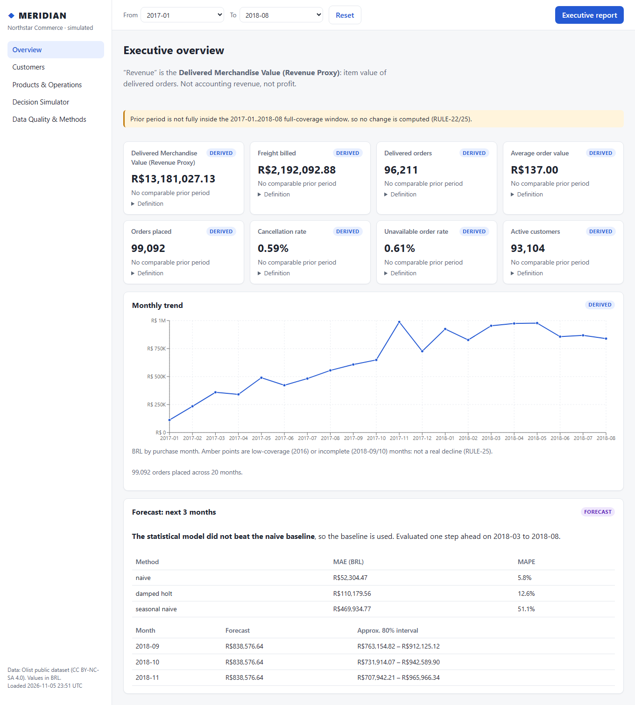
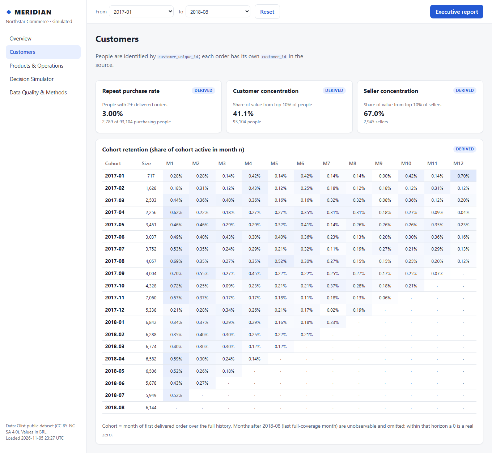
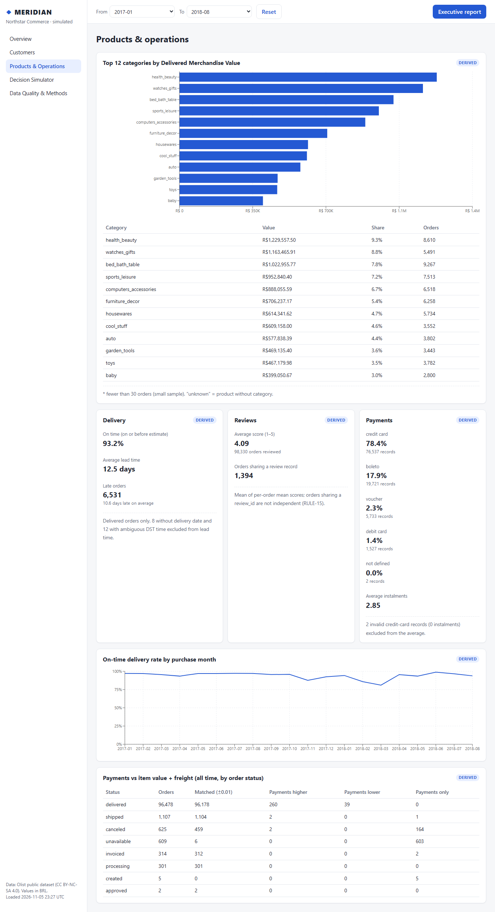
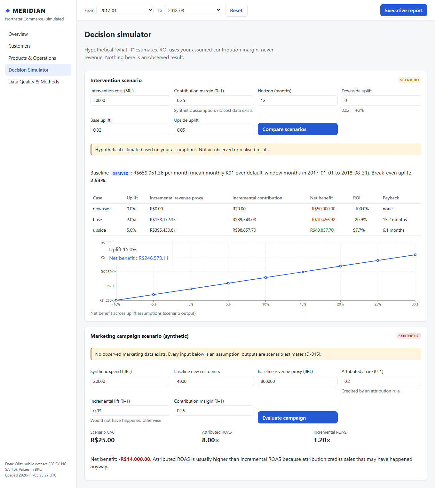
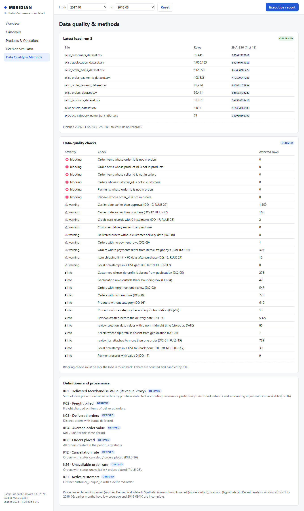

# MERIDIAN — Business & Decision Intelligence Platform

MERIDIAN is an end-to-end analytics product for **Northstar Commerce**, a *simulated* online retailer. Its sales, customers, products, sellers, payments, reviews and deliveries come from the public **Olist Brazilian e-commerce dataset** (about 100k orders, 2016–2018). It turns raw CSV files into a tested MySQL model, reconciled KPIs, an honest forecast, a decision simulator, a FastAPI backend, a React dashboard and an HTML executive report.

**How this was built.** Built by Mayank Pugalia using Claude Code (an AI coding agent) under a phased, test-gated process. I defined the requirements, quality rules and business decisions and approved every phase; Claude wrote the code and documentation. Every number is verified by automated tests and reconciliation checks.



## Business problem
Management needs one trusted view of commercial and operational performance: what changed, where, how reliable the data is, and what a proposed decision might be worth under stated assumptions, without overstating what the data can prove.

Ground rules built into the product:
- **"Revenue" is a proxy:** *Delivered Merchandise Value* = item value of delivered orders. It is **not** accounting revenue or profit, because the data has no costs, refunds or fees.
- Every number is labelled **Observed, Derived, Synthetic, Forecast or Scenario**.
- **No profit, COGS, CAC, ROAS, conversion or churn** is reported: the source cannot support them.
- Comparisons are only shown when both periods are fully covered by data. Edge months (2016, 2018-09/10) are flagged, never hidden.

## Architecture
```
Olist CSVs (local, not in Git)
  → Python ingestion (header validation, SHA-256, one transaction, rollback on failure)
  → MySQL 8: raw_* → stg_* (typed, D-017 timezones) → dim_*/fact_* → canonical KPI views (vw_*) → agg_* (pre-computed copies)
  → Python analytics (independent KPI re-implementation, forecast, simulator)
  → FastAPI /api/v1 (read-only DB account)  → React dashboard (5 pages)  → HTML executive report
  → Power BI (specification + DAX; you build the .pbix)
```

## Technology
Python 3.13 · MySQL 8 · Pandas · versioned SQL scripts · FastAPI · React + TypeScript (Vite, Recharts) · Matplotlib · Statsmodels · Pytest · Ruff · ESLint · Vitest · Playwright · GitHub Actions · Power BI. Dependencies are locked (`requirements/*.txt` with hashes, `frontend/package-lock.json`).

## Features
| Page | What it shows |
|---|---|
| Overview | KPI cards (with prior-period change only when comparable), monthly trend with flagged months, forecast vs baselines |
| Customers | Repeat-purchase rate, customer/seller concentration, cohort retention |
| Products & Operations | Category ranking (small samples flagged), on-time delivery, lead time, reviews, payment mix, payment-vs-order reconciliation |
| Decision Simulator | Base/upside/downside scenarios, break-even, sensitivity, payback; synthetic marketing campaign (attributed vs incremental ROAS) |
| Data Quality & Methods | Latest load, file checksums, 27 data-quality checks, KPI definitions |

| Customers | Products & Operations | Simulator | Data Quality |
|---|---|---|---|
|  |  |  |  |

## Dataset
[Olist Brazilian E-Commerce Public Dataset](https://www.kaggle.com/datasets/olistbr/brazilian-ecommerce), licence **CC BY-NC-SA 4.0** (non-commercial, attribution, share-alike). The data is **not** included in this repository. Download the 9 CSV files manually into `data/raw/olist/`. The MIT licence of this repository covers the code and documentation only.

## Setup (Windows PowerShell; Linux/macOS use `.venv/bin/` instead of `.venv\Scripts\`)
Prerequisites: Python 3.13, Node.js 24, MySQL 8.0 server.

```powershell
git clone https://github.com/maayank05/meridian.git; cd meridian
py -3.13 -m venv .venv
.venv\Scripts\python -m pip install --require-hashes -r requirements/requirements.txt -r requirements/requirements-dev.txt
.venv\Scripts\python -m pip install --no-deps --no-build-isolation -e .
cd frontend; npm ci; cd ..
```

**Database and configuration.** Create the two databases and three least-privilege accounts once, following [docs/setup/PHASE3_PREPARATION.md](docs/setup/PHASE3_PREPARATION.md): `meridian_dev`, `meridian_test`, owner/reader/test users, localhost only. Passwords are generated locally and never displayed. Then copy `.env.example` to `.env` and fill in the three passwords. `.env` is gitignored.

**Load the data** (applies migrations, then a full refresh in one transaction: about 4.5 minutes on first load, about 7.5 minutes on a reload):
```powershell
.venv\Scripts\python -m meridian.ingestion
.venv\Scripts\python scripts/verify_dev_load.py     # reconciles the load against the CSV files
.venv\Scripts\python scripts/reconcile_kpis.py      # SQL KPIs vs independent Python KPIs
```

## Run
```powershell
.venv\Scripts\python -m uvicorn meridian.api.main:app --port 8000     # API + docs at http://127.0.0.1:8000/docs
cd frontend; npm run dev                                               # dashboard at http://localhost:5173
```
Executive report: the **Executive report** button in the app, or `python scripts/executive_report.py` (writes `reports/generated/`).

## Tests
```powershell
.venv\Scripts\ruff check . ; .venv\Scripts\ruff format --check .
.venv\Scripts\python -m pytest          # unit + MySQL integration (meridian_test, synthetic fixture) + profiling scripts
cd frontend; npm run lint; npm run typecheck; npm run test; npm run build
npm run e2e                              # Playwright against the real API and loaded meridian_dev
```
GitHub Actions (`.github/workflows/ci.yml`) runs Ruff, the full pytest suite against a throwaway MySQL 8 container, and the frontend lint/typecheck/test/build. E2E needs the licensed dataset, so it runs locally only.

## Power BI
See [powerbi/README.md](powerbi/README.md): model specification, DAX for the canonical KPIs, build steps and reconciliation targets. No `.pbix` is included; it must be built in Power BI Desktop.

## Documentation
[Learning guide](docs/LEARNING_GUIDE.md) · [KPI dictionary](business/08_kpi_dictionary.md) · [Decisions](docs/DECISIONS.md) · [Data profiling](docs/data/PROFILING_REPORT.md) · [Forecast report](docs/analytics/FORECAST_REPORT.md) · [Quality report](docs/QUALITY_REPORT.md) · [Limitations](docs/KNOWN_LIMITATIONS.md) · [Status](docs/PROJECT_STATUS.md)

## Limitations (summary)
- Revenue proxy only; no cost, refund, marketing or inventory data. Simulator results depend entirely on user-entered assumptions.
- The forecast model does not beat the naive baseline; the naive baseline is used and the report says so.
- Usable history is 20 months (2017-01 to 2018-08). Timestamps are inferred São Paulo local time.
- The full stack runs locally; the public demo is a static snapshot with three simulator presets (D-024). Period filters are whole months. The customers endpoint takes about 1.8 s on the full data.
- Full list: [docs/KNOWN_LIMITATIONS.md](docs/KNOWN_LIMITATIONS.md).

## Licence
Code and documentation: MIT (see `LICENSE`). Data: Olist, CC BY-NC-SA 4.0, not redistributed here.
