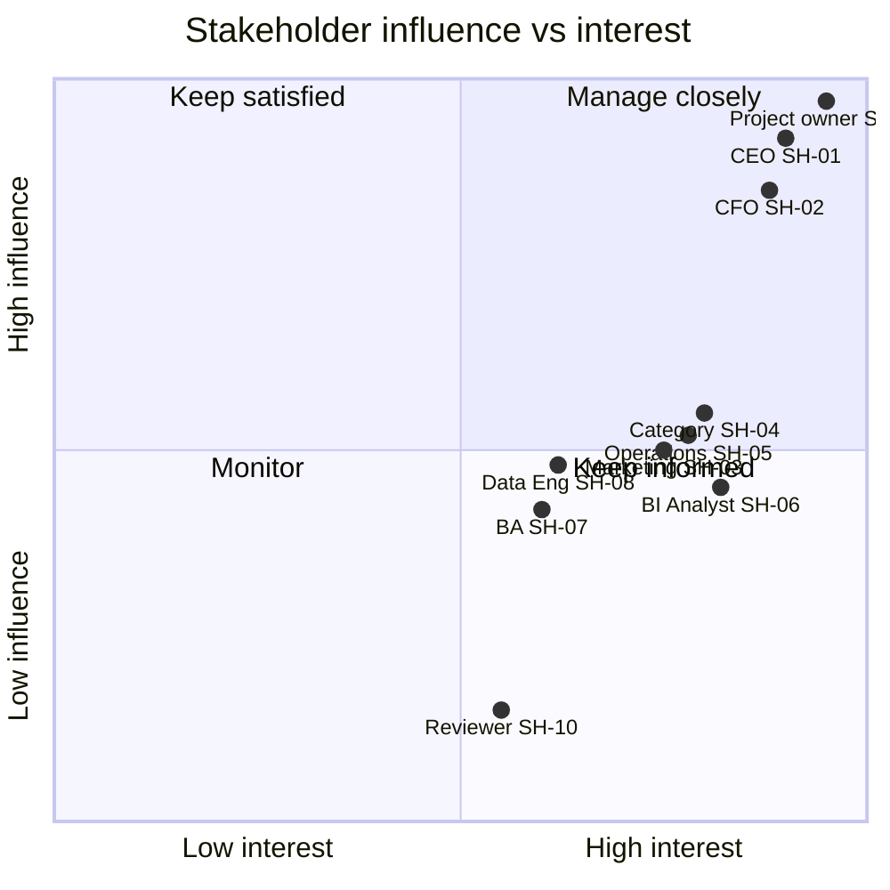

# 02 — Stakeholder Register and Map

Status: Draft v0.1 (Phase 1) · Last updated: 2026-10-31

> Northstar roles are **simulated personas** derived from the target users in `instructions/01`. The project owner and reviewer roles are real project roles.

## Register

| ID | Stakeholder (role) | Type | Primary questions | Modules | Influence | Interest | Engagement |
|---|---|---|---|---|---|---|---|
| SH-01 | Chief Executive Officer | Simulated | What changed, where, and what should we consider doing? | M01, M07, M10 | High | High | Manage closely: monthly executive report, decision reviews |
| SH-02 | CFO / FP&A Lead | Simulated | Which revenue definition, does it reconcile, what would a scenario cost or return? | M06, M07, M01 | High | High | Manage closely: owns revenue and ROI definitions |
| SH-03 | Head of Marketing | Simulated | What can and cannot be said about marketing performance? | M03, M02 | Medium | High | Keep informed: synthetic scenario model, methodology |
| SH-04 | Category / Commercial Manager | Simulated | Which categories, products and sellers drive or drag performance? | M04, M05, M02 | Medium | High | Keep informed |
| SH-05 | Head of Operations | Simulated | Where are deliveries late, and how do they relate to reviews? | M05 | Medium | High | Keep informed |
| SH-06 | BI / Data Analyst | Simulated | Where is each number defined, what is its lineage and quality? | M09, Power BI | Medium | High | Collaborate: KPI and data dictionary |
| SH-07 | Business Analyst | Simulated | Are requirements, rules and acceptance criteria traceable? | M09 | Medium | Medium | Collaborate |
| SH-08 | Data Engineer (data custodian) | Simulated | Is ingestion repeatable, validated and auditable? | Data foundation, M09 | Medium | Medium | Collaborate |
| SH-09 | Project owner (Mayank Pugalia) | Real | Is the product correct, honest, deployable and learnable? | All | High | High | Approves every phase gate |
| SH-10 | Portfolio reviewer / interviewer | Real (external) | Is the work genuine, tested and well reasoned? | All | Low | Medium | Keep informed: README, evidence |

## Map (influence × interest)

Positions are qualitative judgements for communication planning, not measurements.
