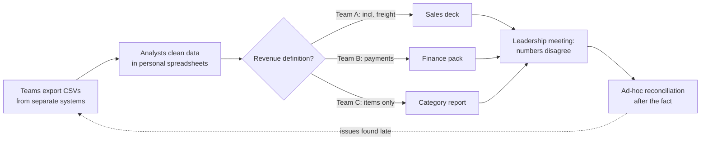
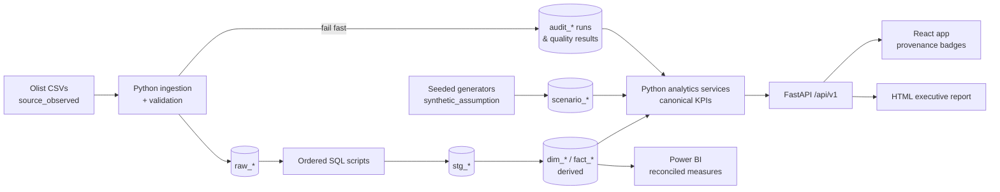
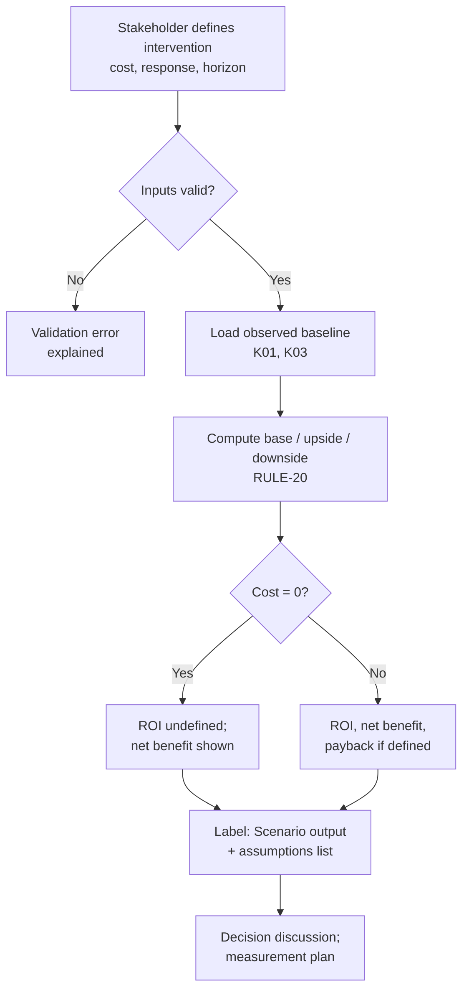
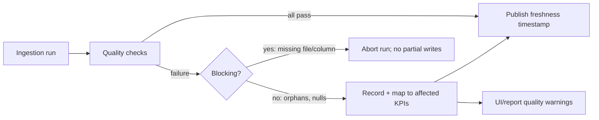

# 12 — Process Maps (AS-IS and TO-BE)

Status: Draft v0.1 (Phase 1) · Last updated: 2026-10-31

> **AS-IS is illustrative.** Northstar is simulated. The AS-IS map describes a *plausible* fragmented reporting process used to motivate the design (A-11). It is not a description of Olist or any real company. The TO-BE map describes MERIDIAN as designed. Components in it are **planned, not built**.

## P-01 AS-IS — Monthly performance reporting (illustrative)

Pain points (illustrative): inconsistent definitions, no quality checks before distribution, no lineage, decisions debated without consistent scenario economics.

## P-02 TO-BE — MERIDIAN data and decision flow (planned)

## P-03 TO-BE — Decision scenario evaluation (planned)

## P-04 TO-BE — Data-quality incident handling (planned)

